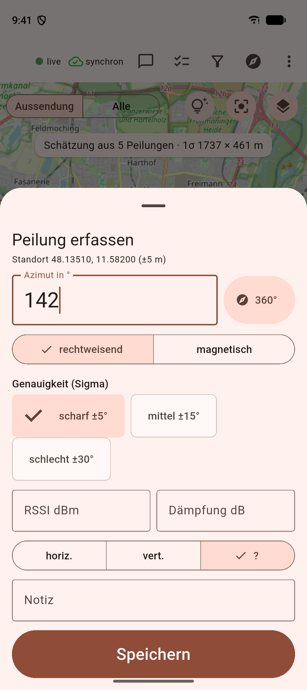
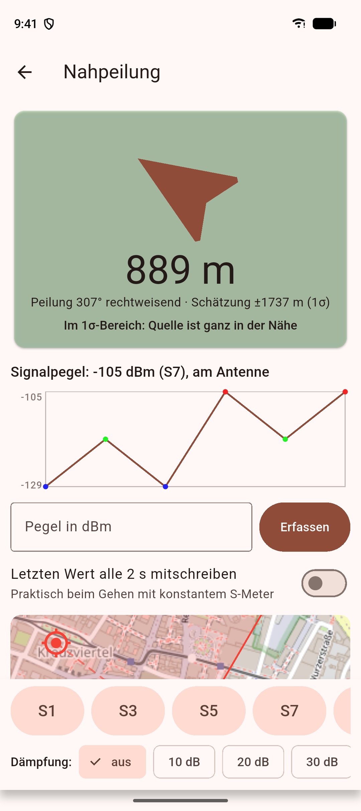

# FoxGrid

[](https://github.com/ceotjoe/FoxGrid/actions/workflows/ci.yml)
[](LICENSE)

FoxGrid is an open-source tool for radio amateurs who locate an interferer on VHF/UHF together (any frequency, for example 2 m,
70 cm or 23 cm, typically on a repeater). Participants record bearings with a position, azimuth, uncertainty and field strength.
The backend fuses them live into the most likely transmitter location, with an error ellipse, and pushes the result to everyone.

<p>
  
  
</p>

## Features

- Live bearing fusion with error ellipses and 50/80/95 % probability contours; outliers are tolerated
- Homing with S-meter and attenuator for the last metres; fixed omnidirectional stations for a coarse area
- Team chat and tasks, push on transmission start, GPX/KML/JSON/PDF export
- Offline-first app (Android, iOS, web control room) with a sync queue
- Invite-link access with approval, device binding, trust levels and a security log
- Optional automatic stations and a repeater hook over MQTT

Bearings are never deleted, azimuths are always stored as true north, and every bearing carries its uncertainty.

## Quick start

Prerequisites: Docker, [uv](https://docs.astral.sh/uv/), Flutter (stable).

```bash
cp .env.example .env            # set passwords and the JWT secret
docker compose up -d --build    # API on port 8000, PostGIS, Redis; migrations run automatically
curl localhost:8000/healthz

cd app && flutter run -d chrome # web control room; server URL http://localhost:8000
```

Create a mission in the app, share the invite from the person icon, and watch a simulated hunt with
`uv run tools/simulator/run.py`. Details: [development setup](docs/development/setup-and-testing.md).

## Repository layout

| Directory | Content |
|---|---|
| `engine/` | `foxgrid_engine`, the direction-finding maths (numpy, pyproj; no web/DB dependencies) |
| `backend/` | FastAPI, SQLAlchemy/GeoAlchemy2, Alembic, WebSocket + Redis |
| `app/` | Flutter app (Android, iOS, web) |
| `tools/` | simulator, MQTT sensor client, relay hook, branding and store asset generators |
| `deploy/` | Caddy and Mosquitto configuration |
| `docs/` | documentation, see [docs/README.md](docs/README.md) |

## Documentation

Start at the [documentation index](docs/README.md): user guide, concepts (domain rules, engine, architecture), API and
configuration reference, operations (deployment, releases, push), development notes and decision records.
Running a server: [deployment guide](docs/operations/deployment.md). Known limits: [limitations](docs/reference/limitations.md).

## Contributing

Contributions are welcome, in English or German: see [CONTRIBUTING.md](CONTRIBUTING.md) and the
[code of conduct](CODE_OF_CONDUCT.md). Report vulnerabilities as described in [SECURITY.md](SECURITY.md).
The privacy policy is in [docs/privacy](docs/privacy/privacy.md).

## License

[MIT](LICENSE)
